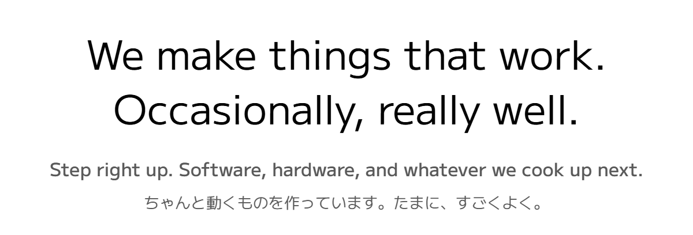
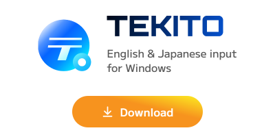
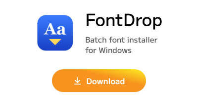
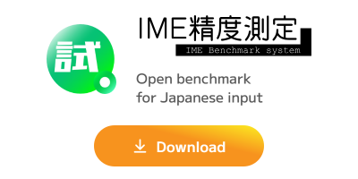

  <a href="https://capitata.dev"><picture><source media="(prefers-color-scheme: dark)" srcset="assets-v19/band-dark.svg"></picture></a> 
  <a href="https://capitata.dev"><picture><source media="(prefers-color-scheme: dark)" srcset="assets-v19/hero-text-dark.png"></picture></a>

  <a href="https://github.com/Canta360/tekito/releases"><picture><source media="(prefers-color-scheme: dark)" srcset="assets-v19/card-tekito-dark.svg"></picture></a> <a href="https://github.com/Canta360/FontDrop/releases"><picture><source media="(prefers-color-scheme: dark)" srcset="assets-v19/card-fontdrop-dark.svg"></picture></a> <a href="https://github.com/Canta360/ime-benchmark-system/releases"><picture><source media="(prefers-color-scheme: dark)" srcset="assets-v19/card-imebench-dark.svg"></picture></a>

